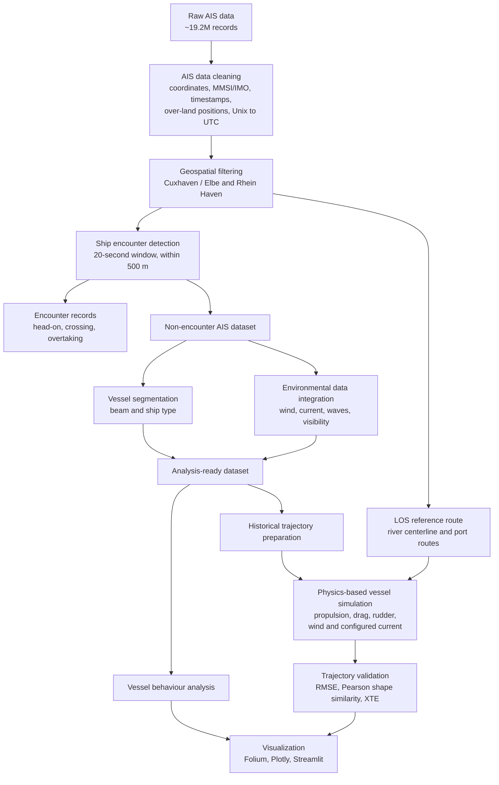

# Simulation and Analysis of Ship Trajectories

## Project Team

- Aishwarya Chincholi Vasant Madhav
- Nishanth Battu
- Vineet Agarwal

## Mentor

- Taruna Tiwari

## Project Milestones Summary

- **M1: Planning and Literature Review (Early May 2025, 2 weeks)**: All three team members reviewed literature on ship trajectory prediction, physics-based maneuvering models, AIS-based environmental analysis, and data-driven approaches.
- **M2: AIS Data EDA and Git Setup (Mid-May to Late May 2025, 3 weeks)**: Aishwarya set up the GitHub repository and completed the project's AIS data cleaning and analysis. This included data quality checks and timestamp preparation, geographic and encounter filtering, vessel and environmental data preparation, and the Cuxhaven/Elbe and Rheinhaven vessel-behaviour analyses documented in this repository.
- **M3: Model Creation and Simulation (Early June to Early July 2025, 5 weeks)**: Nishanth developed the physics-based ship motion model. Aishwarya developed the line-of-sight planning logic used by the model.
- **M4: Model Validation (Early July to Mid-July 2025, 2 weeks)**: Nishanth led model validation, while Vineet validated edge cases across different start and end point scenarios.
- **M5: UI Refinement and Interactive Map (Mid-July to Mid-August 2025, 4 weeks)**: Vineet developed the interactive UI and map-based simulation workflow.
- **M6: Evaluation and Refinement (Mid-August to Late August 2025, 2 weeks)**: Aishwarya and Nishanth evaluated and refined the physics-based model against ground-truth AIS trajectories, while Vineet refined the UI based on model updates.
- **M7: Scientific Writing, Reporting, and Presentation (June to September 2025, parallel)**: All three members documented their respective work. Vineet proofread and maintained the overall report structure and tone.

## Description
A sophisticated simulation framework for ship trajectory modeling that combines physics-based dynamics with historical Automatic Identification System (AIS) data to replicate realistic vessel behavior under varying environmental conditions. This hybrid approach bridges theoretical modeling with practical data-driven insights to advance maritime intelligence and safety.

Core Purpose: Understanding and predicting maritime vessel movement is critical for ensuring navigational safety, efficient port operations, and effective environmental oversight. Our framework addresses this need by integrating real-world navigation patterns with environmental variables to create highly realistic ship behavior simulations.

Key Innovation: Unlike traditional approaches that rely solely on either physics models or statistical methods, our hybrid methodology leverages both:

Physics-based dynamics for fundamental vessel behavior

Historical AIS data analysis for weather impact

Environmental variable integration for condition-specific performance. 

## Data Pipeline & Analysis Architecture

The project turns a large AIS archive into analysis-ready vessel tracks, then uses those tracks to study vessel behavior and validate physics-based simulations. The pipeline covers two contrasting settings: open, tidal water near Cuxhaven/Elbe and restricted inland waterways near Rheinhaven.



### Data preparation and analysis

- **Validate and normalize AIS records:** Parse position and vessel-message fields, reject invalid coordinates and timestamps, check vessel identifiers, and convert reception times to UTC. The project began with approximately **19.2 million raw AIS records**.
- **Define navigable study areas:** Use OpenStreetMap/Overpass geographic context and point-in-polygon filtering to build separate Cuxhaven/Elbe and Rheinhaven datasets. Exclude selected anchorages and other complex areas when preparing open-water samples.
- **Label vessel encounters:** Compare different MMSIs within a **20-second** window, apply a geographic pre-filter, then use Haversine distance to retain pairs within **500 m**. Classify head-on, crossing, and overtaking encounters so interaction cases can be analyzed separately from less-constrained observations.
- **Add vessel and environmental context:** Derive length and beam from AIS vessel dimensions and group vessels into four beam classes: `<10 m`, `10-<23 m`, `23-<33 m`, and `>=33 m`. Fetch hourly weather and marine variables such as wind, visibility, waves, and ocean currents for environmental analysis.
- **Prepare tracks for comparison:** Order observations by vessel and time, interpolate timestamps where needed, and prepare trajectories for SOG/COG analysis and physics-based model evaluation.

### Geospatial Data Preparation & Boundary Creation

- Used OpenStreetMap and Overpass Turbo to inspect waterways, navigation aids, ports, anchorages, and ferry infrastructure around Cuxhaven/Elbe and Rhein Haven; retained the Overpass queries and exported GeoJSON reference layers.
- Defined study-area polygons and applied point-in-polygon filtering with Shapely and MySQL `ST_Within` to create region-specific AIS datasets. Combined selected exclusion polygons to remove anchorage observations where required.
- Maintained separate map-display boundaries for the Streamlit application to visualize the study areas.

See the [geospatial data preparation guide](docs/geospatial_data_preparation.md) for the workflow and links to the boundary files and filtering scripts.

### LOS Route Guidance, Vessel Analysis & Trajectory Validation

- Built reference routes for Cuxhaven/Elbe and Rheinhafen from river centerlines and port geometry; connected LOS route guidance to the physics-based motion controller using heading and cross-track error to steer the rudder.
- Simulated propeller thrust, hull drag, rudder forces, wind, and a configured current scenario. Wind can be fetched from the weather API; current is configured in the simulation rather than live-fed.
- Analyzed SOG under wind/current hindrance across vessel-size categories and inbound/outbound directions; visibility thresholds were used to filter observations in the analysis queries.
- Prepared historical and simulated paths on a common distance grid and evaluated positional RMSE, Pearson-correlation path-shape similarity, and Cross-Track Error (XTE). Used Folium, Plotly, and Streamlit for geographic and interactive visualization.

See the [route guidance and trajectory validation guide](docs/route_guidance_and_trajectory_validation.md) for implementation details and code references.

### Where to look in the repository

- [AIS message parsing and cleaning](Data%20clean%20Cuxhaven/DataCleaner.py) and [UTC timestamp preparation](Data%20clean%20Cuxhaven/Recv%20to%20utc.py)
- [Cuxhaven polygon filtering](Data%20clean%20Cuxhaven/ais%20in%20polygon.py), [anchorage exclusion](Data%20clean%20Cuxhaven/Ais%20outside%20Anchorage.py), and [Rheinhaven polygon filtering](Data%20Clean%20Rheinhaven/Rhein%20ais%20in%20polygon.py)
- [Encounter detection and classification](Data%20clean%20Cuxhaven/Encounter%20filter.py) and [vessel dimension/beam grouping](Data%20clean%20Cuxhaven/Ship%20Size%20Info.py)
- [Historical weather extraction](Data%20clean%20Cuxhaven/Meteo/fetch%20weather%20data.py), [marine condition extraction](Data%20clean%20Cuxhaven/Meteo/fetch%20marine%20data.py), and [environmental analysis notebooks](Analysis/)
- [Simulation evaluation pipeline](Evaluation/CRLB_Data_prep.py) and [interactive Streamlit app](streamlit_app.py)

### Project scale

- Approximately **19.2 million** raw AIS records were considered during data preparation.
- Analysis spans **two** distinct waterways and separates vessel behavior by encounter context, vessel size, and environmental conditions.
- The simulation workflow generated **500+ trajectories** and **1M+ trajectory data points** for computational analysis.

### Model choice and practical constraints

The [Fibion comparison of CNNs, LSTMs, and Transformers for movement modeling](https://web.fibion.com/articles/cnn-vs-lstm-vs-transformer-movement-modeling/) focuses on wearable IMU data, so it provides general sequence-modeling context, not direct evidence about maritime AIS. CNNs learn local temporal patterns, LSTMs model sequential context, and Transformers can capture long-range relationships but require more data and compute as sequence length grows.

Although approximately **19.2 million** raw AIS messages were processed and weather and marine data were prepared, raw message volume did not translate into enough clean, labeled, comparable trajectories for reliable supervised learning and independent validation. Variable AIS reporting intervals, vessel-specific behavior, and hourly environmental observations also require careful track segmentation and time-and-location alignment. Given these data constraints, the project prioritized an interpretable physics-based simulator that could be evaluated against available AIS tracks.

| Model | Practical constraint for this project |
| --- | --- |
| 1D CNN | Would require consistently sized trajectory windows and enough representative examples to learn local motion patterns across vessels and conditions. |
| LSTM/GRU | Would require enough clean, sequential tracks with aligned environmental inputs to learn generalizable temporal behavior rather than vessel-specific patterns. |
| Transformer | Would add greater data and compute demands; long AIS sequences also increase attention cost, without a demonstrated need for that added complexity. |

This was a data-feasibility and project-scope decision, not a head-to-head result showing that neural models underperform. Future work could first compare CNN/LSTM baselines on carefully resampled trajectories, with vessels separated across training and test sets, then consider Transformers if the data scale and need for long-context modeling justify them.

## Streamlit App Deployment

The Streamlit app entrypoint for deployment is:

```text
streamlit_app.py
```

You can deploy this repository directly from GitHub on Streamlit Community Cloud. A dev container is not required for hosting.

### Optional: Enable live wind data

The app can use OpenWeather live wind data when an API key is available. If no key is configured, the simulation falls back to calm wind.

For Streamlit Community Cloud, add this secret in your app settings:

```toml
OPENWEATHER_API_KEY = "your_openweather_api_key"
```

For local development, create:

```text
.streamlit/secrets.toml
```

You can copy the format from:

```text
.streamlit/secrets.toml.example
```

### Visible authorship in the deployed app

The deployed Streamlit UI explicitly shows the project team so all contributors are credited in the app itself, independent of GitHub contributor graph behavior.

## Weather Data analysis

The `Analysis/` folder contains:

- `Analysis/Cuxhaven analysis.ipynb`
- `Analysis/Rheinhaven analysis.ipynb`

The Jupyter Notebook analyzes ship Speed Over Ground (SOG) performance and ship size pattern under various environmental hindrance conditions (wind and current) for different navigation directions.

## Features

- **Database Integration**: Connects to MySQL AIS database
    
- **Environmental Analysis**: Examines wind and current hindrance effects
    
- **Directional Analysis**: Compares inbound vs outbound ship performance
    
- **Visualization**: Box plots and bar charts for performance comparison
    
- **Statistical Aggregation**: Mean SOG calculations and delta comparisons

## Requirements

```bash
pip install mysql-connector-python pandas numpy seaborn matplotlib
```

## Database Configuration

```python
db_config = {
    "host": "localhost",
    "user": "root", 
    "password": "your_password_here",
    "database": "ship_data",
}
```

## Evaluation of physics based ship trajectory model
A complete pipeline for analyzing ship path following performance, from data preparation to simulation comparison.

Note: The evaluation scripts depend on a local MySQL/database setup and the required input data files. The documentation in this README is aligned with the current repository structure, but those scripts will only run when the local database configuration and source data are available.

## System Overview

This system consists of two main components:

1. **File 1: Data Preparation Script** (`Evaluation/CRLB_Data_prep.py`) - Loads and processes historic ship tracks from database
2. **File 2: Analysis Tool** (`Evaluation/CRLB_Simulation.py`) - Compares simulated paths against historic references

## Quick Start

### 1. Install Dependencies
```bash
pip install numpy pandas scipy matplotlib folium shapely mysql-connector-python
```

### 2. Run Data Preparation (File 1)
```bash
# Run from the repository root
# Modify database credentials in Evaluation/CRLB_Data_prep.py
python Evaluation/CRLB_Data_prep.py
```
**Output**: `prepared_historic_tracks.npz`, `track_summary.csv`

### 3. Run Path Analysis (File 2)
```bash
# Run from the repository root
# Modify simulation file paths in Evaluation/CRLB_Simulation.py
python Evaluation/CRLB_Simulation.py
```
**Output**: Performance metrics, visualizations, and comparison reports

## File 1: Data Preparation Script (`Evaluation/CRLB_Data_prep.py`)

### Purpose
Loads historic ship tracks from MySQL database and prepares them for analysis.

### Key Features
- **Database Connection**: Fetches AIS data for specific ships and time windows
- **Coordinate Conversion**: Transforms lat/lon to local Cartesian coordinates (meters)
- **Direction Classification**: Labels tracks as Northbound/Southbound based on bearing
- **Noise Estimation**: Calculates empirical GPS noise (CRLB) for performance benchmarking

### Input Requirements
- MySQL database with AIS data table named `ais_open_water_polygon_env`
- Database credentials (host, user, password, database)
- Ship MMSI numbers and time windows defined in `tracks_to_load`

### Configuration
```python
db_config = {
    "host": "localhost",
    "user": "root", 
    "password": "your_password_here",
    "database": "ship_data",
}

tracks_to_load = [
    {
        "mmsi": 304814000,
        "start_time": "2025-04-27 06:59:17",
        "end_time": "2025-04-27 07:32:19", 
        "id": "H1",
    },
    # ... more tracks
]
```

### Output Files
- `prepared_historic_tracks.npz` - Processed tracks with coordinates, distances, directions
- `track_summary.csv` - Statistics for each track (duration, distance, speed, etc.)

### Data Structure
Each track contains:
```python
{
    'mmsi': ship_identifier,
    'times': timestamps, 
    'lats': latitudes,
    'lons': longitudes,
    'sogs': speeds_over_ground,
    'headings': true_headings,
    'x': local_x_coordinates_meters,
    'y': local_y_coordinates_meters,
    'distances': cumulative_distances_meters,
    'ref_point': reference_coordinates,
    'direction_group': "Northbound"/"Southbound",
    'bearing': compass_bearing_degrees
}
```

---

## File 2: Path Evaluation (`Evaluation/CRLB_Simulation.py`)

### Purpose
Compares simulated ship paths against prepared historic tracks and evaluates performance.

### Key Features
- **Multi-track Analysis**: Compare multiple simulations against multiple historic tracks
- **Comprehensive Metrics**: RMSE, Cross-Track Error (XTE), path similarity index
- **Visualization**: Interactive Folium maps, error plots, path comparisons
- **Performance Benchmarking**: Compare against CRLB theoretical limits
- **Debugging Tools**: Detailed analysis of path discrepancies

### Input Requirements
- `prepared_historic_tracks.npz` from File 1 data preparation
- Simulation JSON files with timestamped position data

### Configuration
```python
# For standard analysis
simulation_files = {
    "sim_S1": "log_data-S1 down.json",
    "sim_S2": "log_data-S2 up.json", 
    "sim_S3": "log_data-S3 up.json",
}

# For R tracks analysis  
simulation_files = {
    "sim_S1": "log_data S1 R Port.json",
    "sim_S2": "log_data -S2 R.json",
    "sim_S3": "log_data S3 R.json",
}
```

### Supported Simulation Format
```json
{
    "point_1": {
        "timestamp": 1234567890.0,
        "latitude": 40.123456,
        "longitude": -74.123456,
        "x_velocity": 0.0,
        "y_velocity": 0.0,
        "heading": 45.0
    }
}
```

### Output Files
- `simulation_performance_results.csv` - All performance metrics in table format
- `true_scale_comparison.html` - Interactive Folium map for path visualization
- Console output with color-coded performance assessment
- Matplotlib plots of cross-track errors and distributions

### Key Analysis Functions
- `compute_simulation_rmse()` - Main RMSE calculation
- `analyze_path_following_performance()` - Comprehensive XTE analysis  
- `calculate_path_similarity()` - Shape correlation (0-1 scale)
- `debug_rmse_calculation_specific()` - Problem diagnosis tool

## Complete Workflow

1. **Prepare Historic Data**: Run `Evaluation/CRLB_Data_prep.py` to load and process database tracks
2. **Generate Simulations**: Run your controller to produce simulation JSON files
3. **Analyze Performance**: Run `Evaluation/CRLB_Simulation.py` to compare simulations against historic data
4. **Review Results**: Check CSV reports, interactive maps, and console assessments
5. **Debug Issues**: Use built-in debugging tools for problematic comparisons
